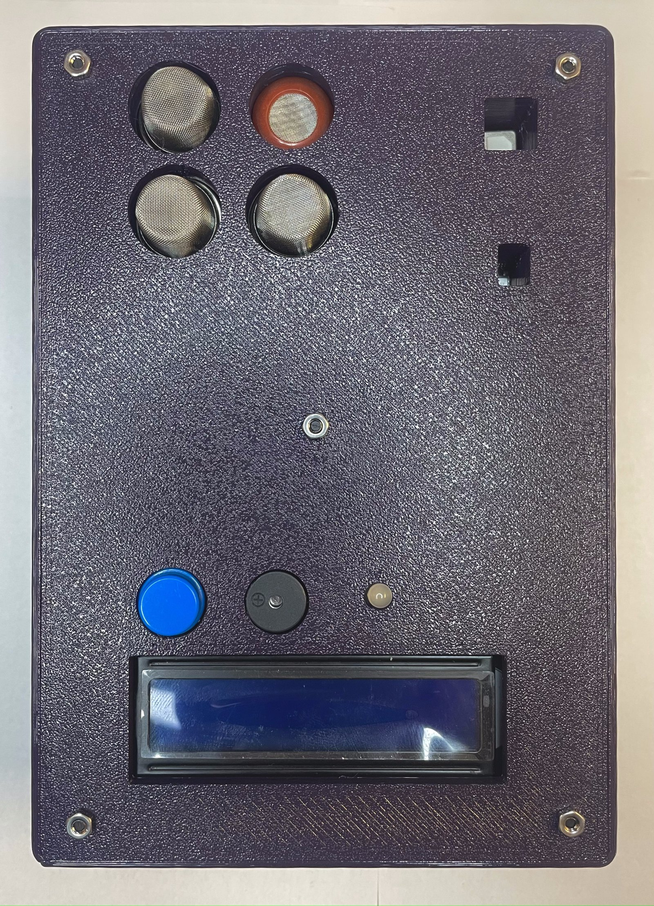
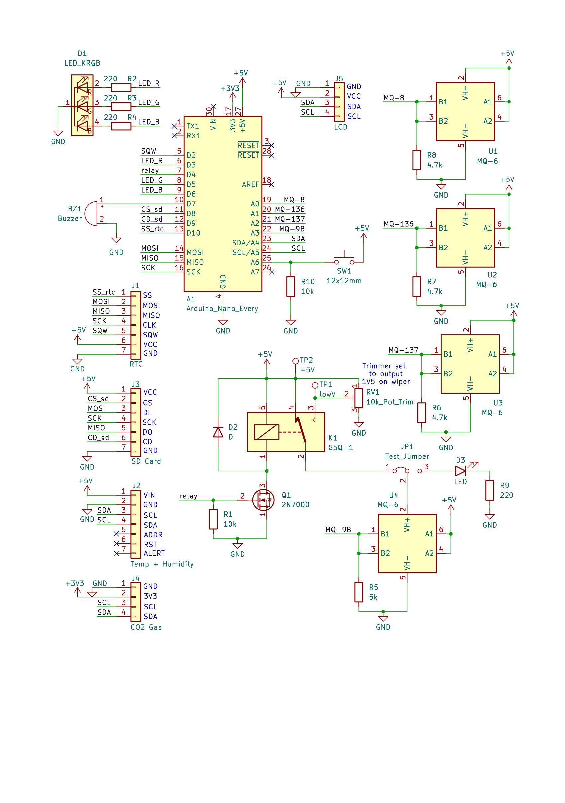
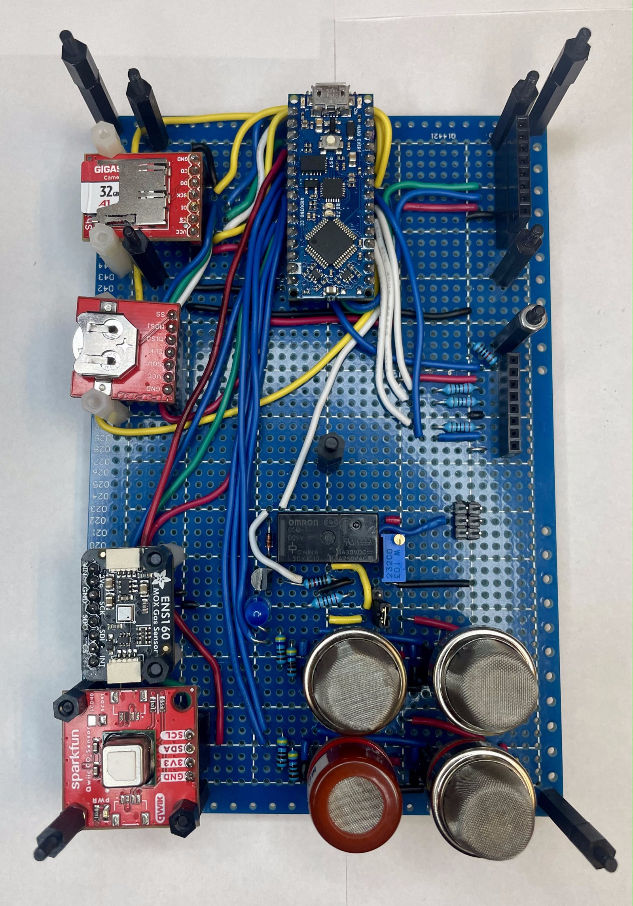
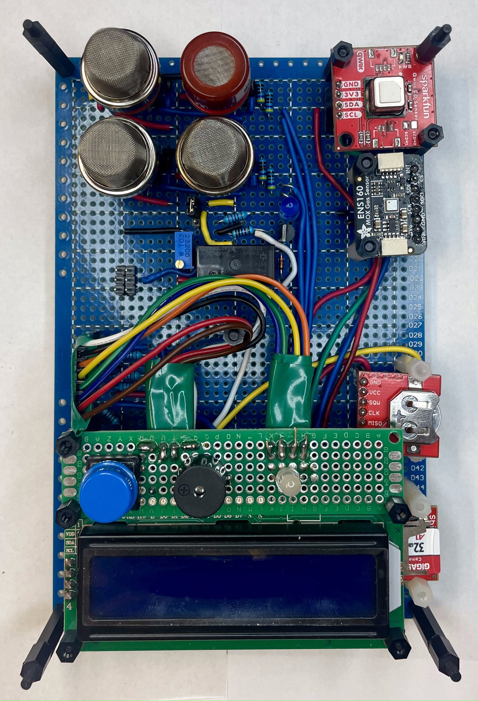
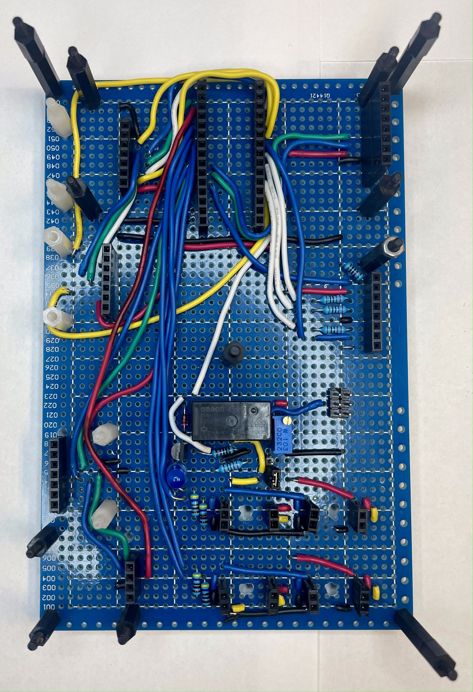
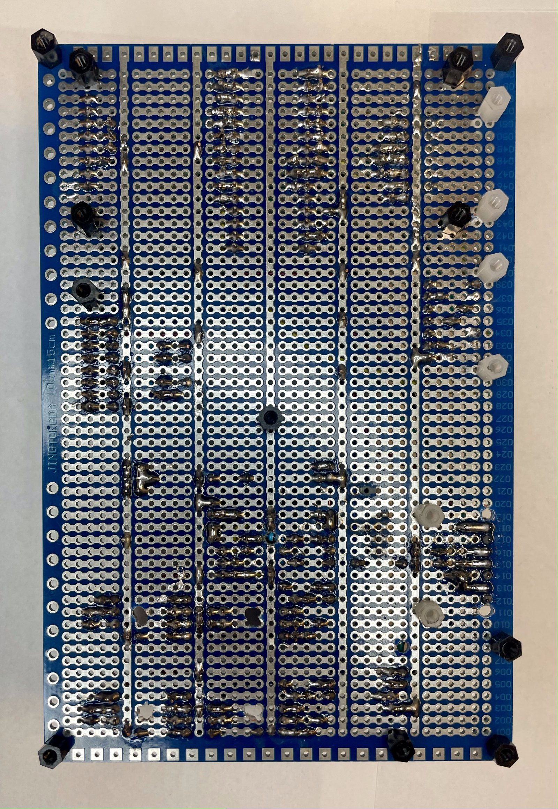
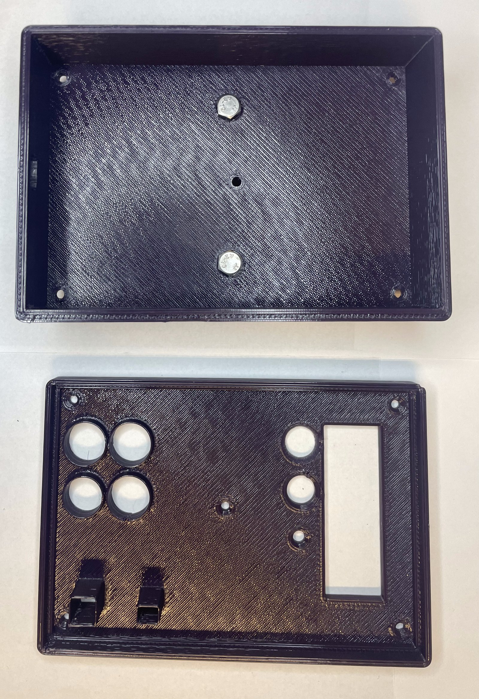
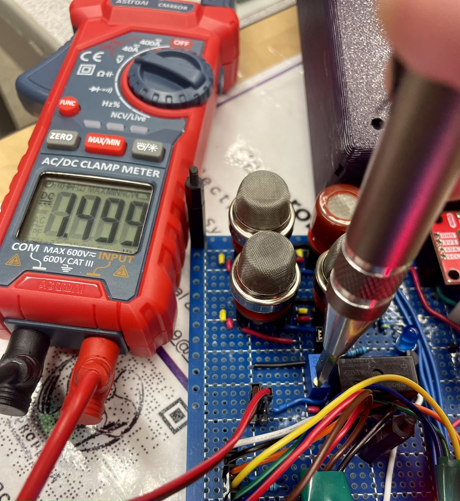
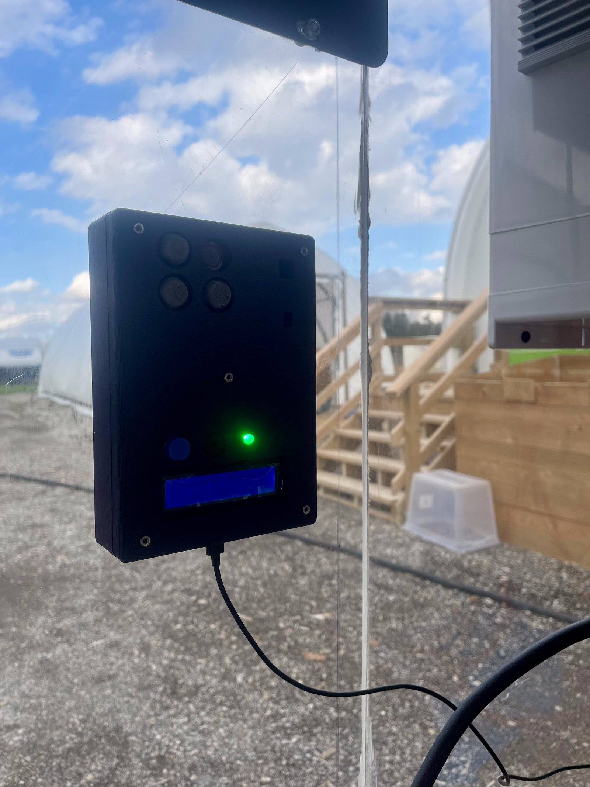

# EnvSafetyLogger

An environmental safety monitor and data logger. It measures CO₂, temperature and
humidity, air quality, and five gases (H₂, H₂S, NH₃, CH₄ and CO), shows them on an
LCD, sounds an alarm above set thresholds, and logs timestamped readings to an SD
card.

It was built for the portable solar-powered electrochemistry station described in
Antonini et al. (2025), [doi:10.3390/technologies13020057](https://doi.org/10.3390/technologies13020057),
where it monitored the air inside the station during electrolysis experiments. The
version published with the paper is tagged
[v1.0.0](https://github.com/uwo-fast/EnvSafetyLogger/releases/tag/v1.0.0).



## What's here

| Path | What it is |
| --- | --- |
| `firmware/main/` | The Arduino Nano Every firmware: `main.ino`, with settings in `config.h`, gas sensor coefficients in `mqGas.h` and alarm levels in `alarmThresholds.h`. See [`firmware/README.md`](firmware/README.md). |
| `hardware/` | The KiCad schematic, with PDF and SVG exports. |
| `docs/` | Build and usage notes ([`docs/README.md`](docs/README.md)), the bill of materials (`BOM_v0.ods`), photos and the MQ sensor datasheets. |
| `data/` | Logs from the station, 6 to 17 November 2024, with the scripts that plot them ([`data/2024-11-pv-box/`](data/2024-11-pv-box/README.md)). |

The 3D-printed enclosure is designed in
[Onshape](https://cad.onshape.com/documents/19c4dfddea3c27460450ef2e/w/2ec8d1afb4664a197accd547/e/7aca4c51ab1e6bf835721462).

## Hardware

### Schematic

The full circuit: the Arduino Nano Every, the sensors, the LCD, button, LED and
buzzer, and supporting circuitry. Designed in KiCad; the files are in `hardware/`.



### Sensors and components

- **SCD41:** CO₂, temperature and humidity.
- **ENS160:** air quality index (AQI), total VOCs and eCO₂.
- **MQ-series gas sensors:** MQ-8 (H₂), MQ-136 (H₂S), MQ-137 (NH₃) and MQ-9B (CO
  and CH₄).
- Circuitry to drive the MQ sensor heaters, an RGB LED and piezo buzzer for alarms,
  an SD card and real-time clock for timestamped logging, and an I2C LCD with a push
  button to page through readings.

The board is built to be modular and serviceable while staying rigid, with headers
and standoffs for every component.





### Soldered board

The board from the component side and from the solder side.




### Enclosure

Printed in PETG with a 0.8 mm nozzle on a Prusa MK3S+, designed to print without
supports.



### MQ-9B heater tuning

The MQ-9B, which detects CO and CH₄, needs its heater cycled between a low and a
high voltage. A relay switches between them, and a trimmer pot sets the relay's
normally-open output to 1.5 V for the low phase. Headers let the heater line be
disconnected and an LED put in its place, to check the heater cycle without the
sensor.



### Installed

Installed and tested in the mobile photovoltaic station used for electrolysis
experiments on wastewater.



## Building the firmware

`just setup` installs the Nano Every core and the libraries the firmware uses, at
the versions CI builds with, and `just check` compiles it. Both need
[arduino-cli](https://arduino.github.io/arduino-cli/) and
[just](https://github.com/casey/just).

The LCD menu library, LiquidMenu, defaults to a parallel LCD, and this board's LCD
is I2C. `just check` selects the I2C library with two compiler flags:

```text
-DLIQUIDMENU_LIBRARY=LiquidCrystal_I2C_LIBRARY -DDisplayClass=LiquidCrystal_I2C
```

In the Arduino IDE, make the same choice in the installed library's
`LiquidMenu_config.h` instead: comment out the `LiquidCrystal` block and uncomment
the `LiquidCrystal_I2C` one.

Calibration and the rest of setup are in [`docs/README.md`](docs/README.md).

## Calibration status

The ppm conversion uses coefficients fitted to the Winsen datasheet curves in 2024.
A later re-derivation gives different coefficients; until that update is made and
checked against a reference gas, use the gas channels for relative changes rather
than absolute ppm or the alarm thresholds. See
[#1](https://github.com/uwo-fast/EnvSafetyLogger/issues/1).

## Future work

- A weather-resistant enclosure with a standard ingress-protection rating.
- Wireless connectivity for remote monitoring.
- Better MQ sensor calibration, building on
  [CameronBrooks11/MQGasSensors](https://github.com/CameronBrooks11/MQGasSensors),
  which re-derives the sensors' coefficients from their datasheets.
- A PCB in place of the protoboard.
- A variant that samples a closed system through a directed inlet.
- Wet Bulb Globe Temperature (WBGT), a measure of heat stress that accounts for
  temperature, humidity, wind and sun.

## Citation

If you use this monitor, please cite the paper (also in
[`CITATION.cff`](CITATION.cff)):

> Antonini, G., Rahman, M. M., Brooks, C., Santoro, D., Muller, C., Al-Omari, A.,
> Bell, K., & Pearce, J. M. (2025). Portable Solar-Integrated Open-Source Chemistry
> Lab for Water Treatment with Electrolysis. *Technologies*, 13(2), 57.
> <https://doi.org/10.3390/technologies13020057>

The paper's other designs and data are on OSF: <https://osf.io/fbdgc/>.

## Licence

GNU General Public License v3.0. See [`LICENSE`](LICENSE).
